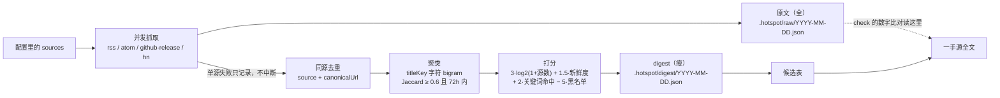
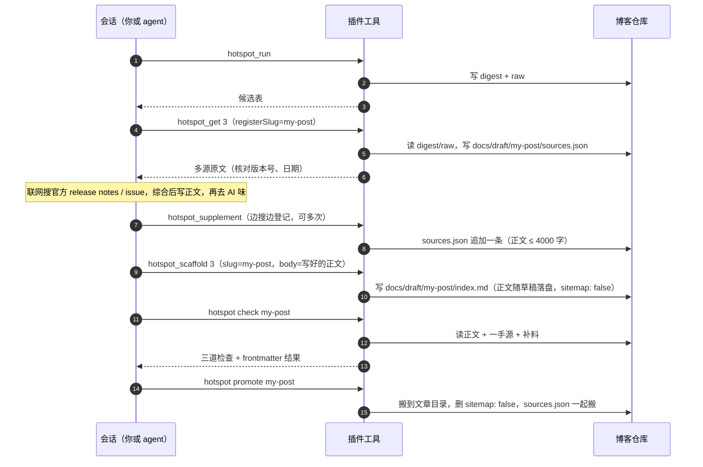
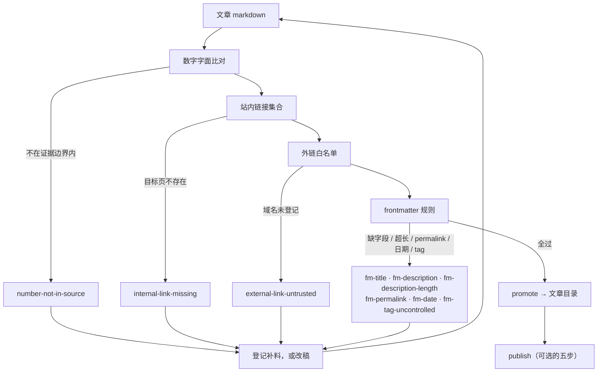
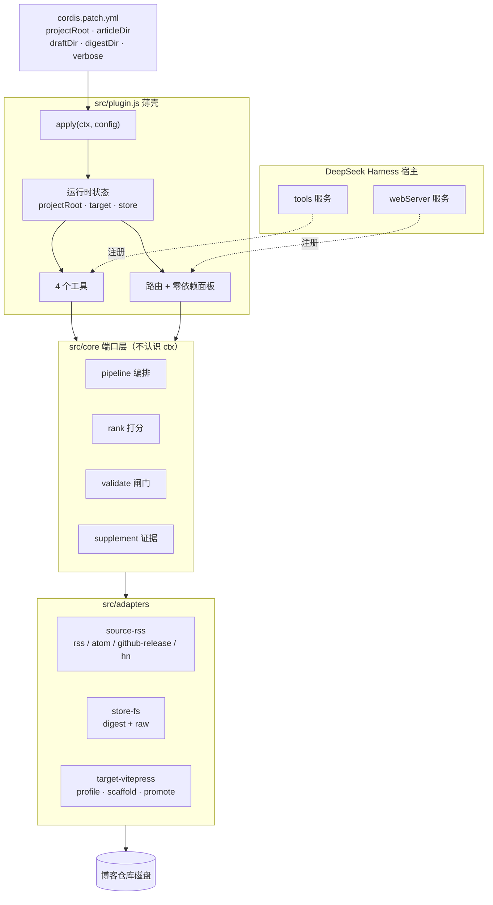

# dsh-hotspot

热点采集 → 去重 → 确定性排序 → 草稿落地。当前只适配 **VitePress** 博客，同时是一个 DeepSeek Harness 插件。

零运行时依赖，纯 ESM JavaScript（Node ≥ 20.6）。`npm test` 用内置 `node:test`，不需要装任何东西。

## 支持哪些博客

**目前只有 VitePress。** 其他生成器（Hexo、Hugo、Astro）需要另写一个 `Target` 适配器——core 不用改，但适配器现在还不存在，`target.kind` 只认 `vitepress`。

"支持 VitePress" 具体意味着这些约定：

| 约定 | 说明 | 可改 |
|---|---|---|
| 文章是 `<目录>/<slug>/index.md` 或 `<目录>/<slug>.md` | 两种布局都能扫到 | — |
| 已发布文章目录 | 默认 `docs/article` | `target.articleDir` |
| 草稿目录 | 默认 `docs/draft` | `target.draftDir` |
| frontmatter 字段 | `title` / `description` / `createTime` / `date` / `tags`，**不写 `permalink`** | — |
| 草稿不进站点地图 | 写 `sitemap: false`，`promote` 时删掉 | — |
| tag 词表 | 从存量文章归纳，同一 tag 的多种写法按小写归并 | — |
| `init` 时项目里要有 `docs/` | 没有就判定"这不是一个 VitePress 项目" | — |

`docs/` 之下怎么分层随你：文章直接在 `docs/` 一级就把 `articleDir` 设成 `docs`，放 `docs/posts/` 就设成 `docs/posts`。草稿目录同理。

`sitemap: false` 只是往 frontmatter 里写一个字段——它变成 `noindex` 是靠你博客侧的插件解释的。如果你的站点不认这个字段，草稿仍然会被搜索引擎抓到，那就改用别的占位手段（或者干脆别把草稿提交上去）。

## 为什么不用模型打分

排序是确定性的算术：

```text
score = 3.0 × log2(1 + 跨源数)
      + 1.5 × 新鲜度(0..1, 半衰期 24h)
      + 2.0 × 关键词命中(权重和, 封顶 1)
      - 5.0 × 黑名单命中
```

理由有三条，都不是"省钱"：

1. **可复现**。同一批数据跑两次结果一致，你能判断候选质量下降是源变差了还是算法抖了。
2. **可解释**。每一条的分都拆进 `scoreParts`，digest 里能直接算给人看。
3. **不引入新的故障模式**。模型排序会编造来源、抬高评分、把转载当首发；那些只能靠"候选集 URL 白名单"打补丁，而补丁本身就是新的耦合。

`whyNow` / `angle` 这类判断留给"你拍板之后"——那时 agent 在会话里有完整上下文，比流水线里盲猜一遍准得多。

## 架构：端口与适配器

core 只认五个接口，不知道自己跑在 DSH 还是 CLI 里：

| 端口 | 职责 | 适配器 |
|---|---|---|
| `Source` | 拉取条目 | rss / atom / github-release / hn |
| `Ranker` | 排序 | 确定性公式 |
| `Store` | 落盘 digest 与原文 | 文件系统 / 宿主 storage |
| `Clock` | 当前时间 | 系统时钟 / 冻结时间（测试） |
| `Target` | 项目知识与草稿落地 | VitePress / （可扩展 hexo、plain、outbox） |

`src/core/` 里不出现 `ctx`、不出现 `article`、不出现 `sitemap`——那些词只准出现在 `src/adapters/target-vitepress.js`。

## 处理流程

整条链路是三段：**采集是批处理，写作是会话里按需触发，校验是发布前的硬闸门**。三段之间只通过磁盘上的文件交接（digest、raw、`index.md`、`sources.json`），没有常驻进程、没有内存状态依赖——所以任何一步都可以隔天重跑。

### 1 采集：一次 run 里发生什么



三个关键性质：

- **单源失败不拖垮整体**。失败的源名进 `status.failedSources`，成功源不足一半时 `degraded: true`，候选表顶部会标「严重降级」。
- **只压同源内部的重复，绝不按 URL 全局去重**。两个源订阅同一个 URL 时会被吞掉一条，而「跨源共现」正是排序里最强的信号（`3.0 × log2(1 + 源数)`）——吞掉就等于把这个信号永久归零。跨源合并是聚类那一步的职责。
- **digest 瘦、raw 全**。digest 只留标题、URL、分数与来源列表；raw 存每个源的完整正文，专门给 `check` 做数字比对用。

### 2 写作：一次成稿的调用顺序



每步落在磁盘上的东西，决定了下一步能看到什么：

| 步骤 | 写入 | 为什么必须落盘 |
|---|---|---|
| `run` | `.hotspot/digest/*.json`、`.hotspot/raw/*.json` | `check` 要拿一手源原文比数字 |
| `get --registerSlug` | `<draftDir>/<slug>/sources.json` | digest 按天滚动，隔天 latest 里已无该 cluster，来源会丢 |
| `scaffold` | `<draftDir>/<slug>/index.md` | frontmatter 由程序生成；传 `body` 时正文一起落盘，不传才写占位 |
| `supplement` | 同一个 `sources.json` | 补料是**证据账本**，不是笔记 |
| `promote` | `<articleDir>/<slug>/{index.md,sources.json}` | 转正后仍要答得出「这段数字从哪读来的」 |

面板的「AI 写正文」是同一套落盘的另一种触发：子代理把 `{ body, sources }` 写成 `<digestDir>/writer/<slug>.json`，宿主读回后登记补料、写正文、跑校验（见「面板里一键写正文」）。

### 3 校验：四道闸门



「证据边界」是三层叠加的：**候选源原文**（digest + raw）、**已登记的补料**（`sources.json`）、**配置里的 `publish.allowedHosts`**。闸门不会因为 `--allow` 变松——它只会因为「你真的读过」而变宽。

## 快速开始

在**你的博客仓库根目录**下跑（`--root` 就是博客项目路径，不是本仓库）：

```bash
node src/cli.js init --root <你的博客目录>   # 生成配置文件，并从存量文章归纳 tag 词表
# 编辑配置里的 sources，换成你关心的源
node src/cli.js run --dry-run                # 只看不落盘
node src/cli.js run                          # 落 .hotspot/digest/YYYY-MM-DD.{json,md}
node src/cli.js scaffold '#3' --body-file post.md  # 一次成型：正文随草稿落盘（省略 --body-file 只写骨架）
node src/cli.js supplement <slug> --url <页面> --file <正文>  # 联网补到的证据，登记后 check 才认
node src/cli.js check <slug>                 # 三道机械校验
node src/cli.js promote <slug>               # 转到文章目录，去掉 sitemap:false
node src/cli.js publish <slug> --yes         # 校验 → 构建 → 只提交这一篇 → 推送 → 部署
node src/cli.js doctor --online              # 自检：配置 / 目标项目 / 每个源 / DSH 安装状态
```

`init` 写出的 `sources` 只是示例，务必换成你自己领域的源——跨源共现信号要多个源覆盖同一领域才有意义（见「已知限制」）。

## 怎么确认它真的可用

分三层，从便宜到贵。**下层不过就别看上层**，否则会把"配置错"误判成"插件坏了"。

| 层 | 命令 / 动作 | 通过的标准 |
|---|---|---|
| 1 项目侧 | `hotspot doctor --online` | 没有 ✗；源能连通、能扫到文章、tag 词表非空 |
| 2 打包侧 | `dsh --profile <名字> --dump-config \| grep -A6 hotspot` | 配置树里出现 `- id: hotspot`，config 正确 |
| 3 运行时 | 启动后在 App 里打开 `<地址>/dsh-hotspot/` | 页面能开、`/api/state` 有数据、会话里能调 `hotspot_run` |

第 2、3 层依赖 DSH 装好并重启。第 3 层是最关键的一层，因为前两层都可能"看起来正常但实际没生效"——踩过的两个坑（`output.render` 返回裸字符串、`output.schema` 写了 `required`）都属于这种静默失败。判断办法：`cordis.patch.yml` 里把 `verbose` 设成 `true`，启动日志应出现

```text
[dsh-hotspot] dsh-hotspot: 插件已加载，projectRoot=/path/to/blog
[dsh-hotspot] tools 服务就绪=true
[dsh-hotspot] 已注册 4 个工具：hotspot_run / hotspot_get / hotspot_scaffold / hotspot_supplement
[dsh-hotspot] 已注册 N 条路由，管理页 /dsh-hotspot/
```

四行缺哪一行，问题就在哪一层：第一行缺失 = 模块没被加载（看 `did not activate` 列表）；第二行 false = tools 服务没起来；第三行缺失 = 注册抛异常了（异常被 Cordis 吞掉，插件里的 try/catch 会打出来）；第四行缺失 = webServer 没就绪。

## 写正文：先补料，再去 AI 味

骨架是确定性生成的，正文不是。正文要有信息量，就得离开候选源去查官方 release notes、作者博客、issue/PR——那些页面里的版本号和日期，一手源里没有，`check` 会把它们判成编造。

补料（supplement）是这条缝的解法：把"实际读过什么"登记成证据，让闸门知道**证据边界在扩**，而不是用 `--allow` 把闸门关掉。

```bash
node src/cli.js supplement <slug> --url <页面> --file <本地正文> --kind official
node src/cli.js supplement <slug> --list     # 看已登记的补料
```

登记后 `check` 做三件事：补料原文并入数字比对、补料 URL 与域名并入外链白名单、配置里的 `publish.allowedHosts` 继续生效。文件落在 `<draftDir>/<slug>/sources.json`，`promote` 时一起搬到文章目录——转正之后仍答得出"这段数字是从哪读来的"。

草稿要一次成型：写完、去完 AI 味，再用 `scaffold --body-file` 把正文一起落盘，草稿目录里不会出现「（正文待写）」。

```bash
node src/cli.js scaffold '#3' --slug my-post --title '中文标题' --body-file post.md
# 落盘即校验：违规直接列出来，草稿保留，改完重跑 hotspot check
```

`--title` / `--description` 覆盖 frontmatter（正文是中文时基本都要传，否则会沿用英文 RSS 标题）。正文自带 `# 标题` 就原样使用，没有才自动补一个。

顺序是硬的：**写 → 去 AI 味 → check**。去味会改数字写法（`6.1.2` → `v6.1.2`）和删链接，先 check 等于白跑一遍。

DSH 里对应 `hotspot_supplement` 工具：边搜边登记，别等 check 报错再回头补。

两处配套，省掉手工登记：

- **`hotspot_get` 带 `registerSlug`**：把该候选的多源原文一次性登记成补料。digest 按天滚动，隔天再写这篇草稿时 `latest` 里已经没有这个 cluster，check 也就不再自动认它的来源——写之前先固化一份。
- **面板里的证据条**：打开草稿/文章的「预览与修改」后，正文上方有一条 `📎 证据 N 条`，展开可看每条补料的标题、类型、字数与正文摘要。转正后这条也还在，因为 sources.json 跟着一起搬走了。

### 面板里一键写正文

草稿列表每条右边有「AI 写正文」。点下去，插件用宿主的**子代理**跑一次「搜 → 读 → 写」，然后把结果按同样的规矩落盘：

```
子代理（有搜索与抓取工具，自己决定读哪几篇）
  └─ 写产物 → <digestDir>/writer/<slug>.json   { body, sources:[{url,title,content}] }
        └─ 宿主读回：来源登记成补料 → 正文写进草稿（保留 frontmatter）→ 立刻跑三道校验
```

几处刻意的设计：

- **写盘和闸门不在模型手里**。子代理只产出 JSON，登记补料、写正文、跑校验都是确定性的宿主代码——模型再能编，也进不了「已校验通过」。
- **来源原文一起交回来**。产物里的 `sources[].content` 会进 `sources.json`，数字闸门才认得出正文里的版本号；没带原文的来源只记一条「没有原文，数字无法比对」，不当作证据。
- **走子代理而不是单次 completion**。写一篇有出处的文章要「搜 → 读 → 交叉核对」，那是 agent 的能力面；`llm` 服务只能生成，不含联网搜索。
- **慢是正常的**。一次几秒到几分钟，按钮期间禁用；默认 8 分钟超时，超时抛错不写草稿。
- **没接子代理就明说**。宿主没提供 `subagents` 服务时接口回 501，面板提示「当前环境没有接入写作子代理」，不会假装写成。

产物落在 `<digestDir>/writer/<slug>.json`，跟 digest 同生命周期，方便事后查「这次是谁、读了什么、写了多少字」。

## 三道机械校验

发布前必须全过，否则文章只能留在草稿目录：

| 检查 | 拦什么 | 实现 |
|---|---|---|
| 数字字面比对 | 把 `24.9` 写成 `24.10`、把版本号记错 | 文章里的 `\d+(\.\d+)+` 必须出现在一手源或已登记的补料原文里 |
| 站内链接集合 | 死链 | 扫站点 `docs/` 下所有含 `index.md` 的目录建 URL 集合（外加 `docs/public/*.html`），逐个命中 |
| 外链白名单 | 编造来源 | 必须来自候选源、已登记的补料域名，或配置里登记的域名 |

外加 frontmatter 规则：description ≤ 120 字、不写 `permalink`、date 格式、tag 必须来自受控词表（词表从存量文章归纳，同一 tag 的多种写法按小写归并）。

一手源原文单独存 `.hotspot/raw/<date>.json`，不放进 digest——digest 要瘦，数字校验要全。

## 自动发布：三档，默认只开第一档

| 档位 | 产物 | 判定 |
|---|---|---|
| `auto` | 直接进文章目录 | 一手 release 类，白名单源，版本号跨源一致 |
| `draft` | 草稿目录，带 `sitemap:false` | 默认档 |
| `manual` | 只进 digest | 传闻、冲突、黑名单命中 |

`publish.autoTiers` 默认为空数组。要开自动直发就往里加源类型，不要改代码。

### publish 会执行什么

`publish` 只做五步，且**只 `git add` 这一篇的目录**：

```bash
yarn build                              # 构建（死链检查通常在这里拦第一道）
git add <articleDir>/<slug>             # 只 add 这一篇
git commit -m "post(auto): <slug>"
git push origin HEAD
./deploy.sh --no-git --skip-build       # 部署
```

不用 `git add -A` 是有意的：自动发布时工作区通常有你的半成品，一个 `add -A` 就把它们全提交并发上线了。

⚠️ `publish` 的构建与部署命令仍**写死在 `src/cli.js` 的 `cmdPublish`**（`yarn build` 与 `./deploy.sh --no-git --skip-build`）。这不是通用约定，是作者自己站点的流水线——命令行发布若用别的构建/部署方式，要么改这两行，要么别用 `publish`，手动执行上面五步。

### 面板里的「部署站点」按钮（可配置）

控制面板与插件页头各有一个「部署站点」按钮，它执行的命令**由配置决定，不写死在代码里**：

```json
{
  "deploy": { "script": "npm run build && ./deploy.sh --no-git --skip-build" }
}
```

- 在「设置 → 站点部署」里填写脚本，或 POST `/hotspot/api/config` 带 `{"deploy":{"script":"…"}}`。
- **留空即解绑**：`deploy.script` 为空时页头不渲染按钮，接口返回 `ERR_NO_DEPLOY_SCRIPT`，没有配置就没有入口。
- 脚本在 `projectRoot`（博客项目根目录）下由 `/bin/sh -c` 执行，单次超时 10 分钟，stdout/stderr 各保留末尾 64KB；结果弹窗展示命令、cwd、退出码、耗时与输出。
- 并发请求会被 `ERR_DEPLOY_BUSY`（409）挡住，同一时间只跑一次；根目录失效则返回 `ERR_NO_BLOG_ROOT`。
- 路由和其他面板接口一样只接受 loopback 同源请求，不额外做命令沙箱——**谁能拿到这个面板，谁就能执行这条命令**。

## 插件原理

插件只做三件事：**把 core 的端口接到 `ctx` 上、把能力暴露成工具、把状态暴露成页面**。它自己不实现任何业务逻辑——`src/plugin.js` 里出现的最复杂的判断是「有没有配置博客根目录」。



三条边值得单独说：

1. **宿主 → 薄壳是注册，不是调用**。工具和路由都是 `ctx.inject([服务名], sctx => sctx.effect(...))` 里注册进去的，`effect` 返回的 disposer 负责卸载。所以插件热重载不会留下僵尸路由。
2. **薄壳 → core 是端口注入**。`runScan` 每次调用都现场 `createPipeline({ sources, ranker, store, clock })`，core 拿到的全是函数和对象，没有一个是 `ctx`。
3. **core → 适配器是唯一的落盘口**。`src/core/` 里没有一处 `writeFile`，写博客目录的代码只在 `target-vitepress.js` 里。

### 配置从哪来

| 来源 | 生效时机 | 能改什么 |
|---|---|---|
| `cordis.patch.yml` 的 `config` | `apply` 入参，启动时 | `projectRoot` / `articleDir` / `draftDir` / `digestDir` / `limit` / `verbose` |
| 工作区根目录的 `dsh-hotspot.config.json` 或 `hotspot.config.json` | 启动时读一次（`projectRoot` 为空则整段跳过） | `projectRoot` 及其 `digestDir` / `articleDir` / `draftDir` |
| 面板「设置」页 | 运行时，走 `onConfigUpdated → updateRuntime` | `projectRoot` / 目录名 / `digestDir`（rank、publish 写回配置文件，下次启动生效） |
| 工具参数 `projectRoot` | 单次调用 | 临时指定另一份博客仓库，不改全局状态 |

优先级从上到下**后者覆盖前者**（工具参数只影响那一次调用）。

两个已知的不一致，写在这里免得踩坑：

- **缺省文章目录不同**。插件侧 `articleDir` 缺省 `docs`（最早只服务「文章直接放 `docs/` 下」这种布局），而 CLI 走适配器默认值 `docs/article`（`src/adapters/target-vitepress.js` 里的 `config.articleDir ?? 'docs/article'`）。插件的默认值会盖掉适配器的默认值，所以同一个仓库在插件里和 CLI 里可能指向不同目录——配置里显式写死 `articleDir` 就没有歧义。
- **配置键不同**。插件读顶层的 `articleDir` / `draftDir` / `digestDir`，CLI 读 `target.articleDir` / `target.draftDir`。两个键写在同一个文件里，各读各的。

### 没配置博客目录时会怎样

`projectRoot` 为空或路径不存在 → 进入**未绑定状态**：`target = null`。

| 能力 | 未绑定时的行为 |
|---|---|
| `hotspot_run` | 照常跑，但画像为空（没有 tag 词表、没有关键词加权），排序只剩新鲜度与源数 |
| `hotspot_get` | 照常读 digest；带 `registerSlug` 会返回「尚未配置博客项目根目录」 |
| `hotspot_scaffold` / `hotspot_supplement` | 返回同一条提示，不抛异常 |
| 面板 | 能开，能在「设置」里填路径，填完立即生效 |

刻意的取舍：**没有默认目录**。猜一个 `~/blog` 然后往里面写文件，比明确报错糟糕得多。

### 四个工具

| 工具 | 参数 | 读 | 写 |
|---|---|---|---|
| `hotspot_run` | `limit?` | 配置文件里的 sources | `.hotspot/digest/*.json`、`.hotspot/raw/*.json` |
| `hotspot_get` | `id`、`registerSlug?` | digest + raw | 仅当传 `registerSlug`：`<draftDir>/<slug>/sources.json` |
| `hotspot_scaffold` | `id`、`slug?`、`title?`、`description?`、`body?`、`projectRoot?` | digest | `<draftDir>/<slug>/index.md` |
| `hotspot_supplement` | `slug`、`url`、`title?`、`content?`、`kind?`、`projectRoot?` | `sources.json` | 同文件追加/覆盖 |

`hotspot_get` 是唯一「读的时候可能写」的工具，因为 digest 按天滚动：隔天写同一篇草稿时，latest 里已经没有那个 cluster，`check` 也就不再认它的来源。写正文前用 `registerSlug` 把证据固化一次，是最省事的做法。

### 路由与面板

每个路径同时注册在两个前缀下：`/dsh-hotspot` 和旧前缀 `/hotspot`。所以启动日志里的路由条数是**路径数的两倍**——看到数字对不上先想想这一条。

面板是一个零依赖 HTML（`src/web/panel.html`，脚本内联），不打包、不引框架，由路由直接吐出字符串。所有数据走 `/api/*` 的 JSON 接口，所以面板坏掉时可以直接 curl 排障。

`POST /api/generate` 是唯一会起子代理的接口（`{ slug }` → 写正文 + 跑校验）；宿主没提供 `subagents` 服务时它回 501，其余接口不受影响。

**刻意没做的**：不注册 `/slash` 命令、不注册定时任务。前者要猜命令 outcome 的契约；后者宿主已有「自动化任务」，让它定时调 `hotspot_run` 就行。少两处耦合，就少两处随 DSH 版本失效的地方。

## DSH 插件

`src/plugin.js` 是薄壳（结构见上一节）：把 core 的端口接上 `ctx`，然后就没它的事了。

**已在真实运行时验证**（DeepSeek Harness 0.2.1-rc.5，`dsh web --port 0`）：apply 执行、`tools` 服务就绪、四个工具注册成功。

接口是从已安装插件的源码里读出来的，不是猜的：

```js
import { defineTool } from '@deepseek-ai/dsh-tools'

export function apply(ctx, config) {            // 具名导出，不用 export default
  ctx.inject(['tools'], (sctx) => {
    sctx.effect(() => {
      const dispose = sctx.tools.register(defineTool({
        name: 'hotspot_run',
        description: '...',
        parameters: { limit: { type: 'number', description: '...' } },  // 扁平 map，不是 JSON Schema
        output: {
          schema: { type: 'object', additionalProperties: false, properties: {...} },
          render(_args, value) { return [{ type: 'text', text: '...' }] },  // 必须返回 ContentBlock[]
        },
        async execute(args) { return {...} },
      }))
      return () => dispose?.()
    })
  })
}
```

两个踩过的坑，写在这里免得再踩：

1. **`output.render` 必须返回 `ContentBlock[]`**。返回裸字符串不会立刻报错，而是在 `tools/post-execute` 阶段把下游消费者（如 hooks）打崩。
2. **`output.schema` 不支持 `required: [...]`**。DSH 用的是自有 value schema DSL，写了会抛 `unsupported JSON schema: schema.required is not supported`，而 Cordis 会把 `inject` 回调里的异常静默掉——表现是"插件加载了但工具不存在"。所以 `plugin.js` 里注册块被 try/catch 包住并显式 `console.warn`，这个包装不要拆。

刻意没做的：**不注册 `/slash` 命令、不注册定时任务**。前者要猜命令 outcome 的契约；后者宿主已有「自动化任务」，让它定时调 `hotspot_run` 就行。少两处耦合，就少两处随 DSH 版本失效的地方。

### 安装

```bash
# 官方入口（走 pnpm，会写 profile 的 dependencies）
dsh plugin --profile <profile> add <本仓库路径>

# 然后把 hotspot 加进 profile 的 dsh.profile.bundles
#   ~/.dsh/profiles/<profile>/package.json
```

`cordis.patch.yml` 会作为一层 patch 自动应用（见 `package.json` 的 `dsh.bundle.patch`），里面的 `config` 就是配置面，改它不用改代码。

验证加载是否成功：`cordis.patch.yml` 里把 `verbose` 设为 `true`，启动后应看到

```text
[dsh-hotspot] dsh-hotspot: 插件已加载，projectRoot=...
[dsh-hotspot] tools 服务就绪=true
[dsh-hotspot] 已注册 4 个工具：hotspot_run / hotspot_get / hotspot_scaffold / hotspot_supplement
```

## 管理界面

插件启动后会在 DSH 的 web server 上挂一组路由，打开：

```text
<你的 DSH 地址>/hotspot/
```

四个页签：

| 页签 | 能做什么 |
|---|---|
| 源 | 增删 RSS / GitHub releases / HN 三种源，保存即写回配置文件 |
| 候选 | 看当日候选、分数、多个来源的原文摘要，一键生成草稿 |
| 内容 | 草稿与已发布文章列表，可预览、在线编辑、转正 |
| 设置 | 候选上限、时间窗、半衰期、去重阈值、外链白名单、部署脚本；画像 tag 与关键词只读展示 |

接口都在 `/hotspot/api/` 下，普通 Node http handler，可直接 curl：

| 方法 | 路径 | 说明 |
|---|---|---|
| GET | `/hotspot/api/state` | 一次返回 sources / config / articles / drafts / 最新 digest |
| POST | `/hotspot/api/sources` | 整体写入源列表（带 id 与字段校验） |
| POST | `/hotspot/api/config` | 局部更新 projectRoot / 目录 / rank / publish / deploy.script |
| POST | `/hotspot/api/run` | 触发一次抓取 |
| POST | `/hotspot/api/scaffold` | 按候选 id 生成草稿 |
| GET | `/hotspot/api/article` | 读正文，附带 `supplements`（补料条数与摘要） |
| POST | `/hotspot/api/article` | 保存正文 |
| POST | `/hotspot/api/article-promote` | 草稿转正 |
| POST | `/hotspot/api/deploy` | 执行 `deploy.script`（未绑定 → 400，已在跑 → 409），返回退出码与输出 |

**为什么不做 React 客户端插件**：`dsh.client` 需要引入客户端构建链，还要绑定预发布期的客户端 UI API。这几个页面都是表格和表单，单个零依赖 HTML 足够；省下的是一整条会随 DSH 版本失效的耦合。

**安全**：插件路由不走平台鉴权（`webServer.register` 的语义如此），所以自己守一道——只接受 loopback 来源、拒绝 `sec-fetch-site: cross-site`、`origin` 与 `host` 必须同源。这三条对应 `src/server/api.js` 的 `isAllowed()`。

## 已知限制

- **只支持 VitePress**。换生成器要写 `Target` 适配器（`src/adapters/target-vitepress.js` 是唯一实现）。
- **`publish` 的构建/部署命令写死**（`yarn build`、`./deploy.sh --no-git --skip-build`）；面板的「部署站点」按钮不走这套逻辑，只执行配置里的 `deploy.script`。
- **`github-release` 源走 releases.atom**，不需要 token。本地网络若访问不了 github.com，该源会失败并在 digest 状态行里列出来——单源失败不影响其他源。
- **跨源共现信号要有重叠才生效**。如果几个源各覆盖一块不重叠的领域（比如 HN + 一个官方博客），所有条目 `sourceCount` 都是 1，共现项退化成常数，排序实际由新鲜度和关键词决定。想让这个信号有意义，得让多个源覆盖同一领域。
- **中文标题不生成拼音 slug**，`slugHint` 可能为空，`scaffold` 会要求显式 `--slug`。这是刻意的：拼音目录名后面还得手工重命名。
- **digest 不进版本库**（`.hotspot/` 已 gitignore）。它是过程产物；真正要留痕的判断应该写进文章或 commit message。
