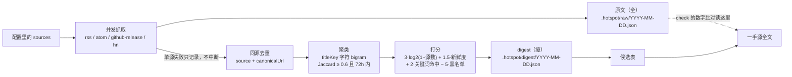
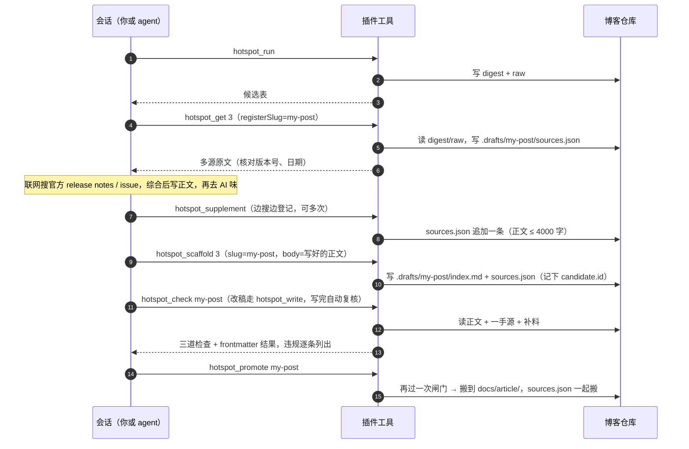
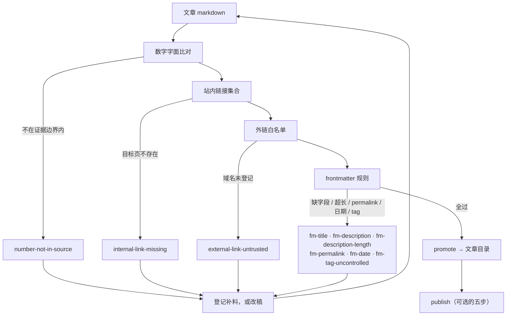
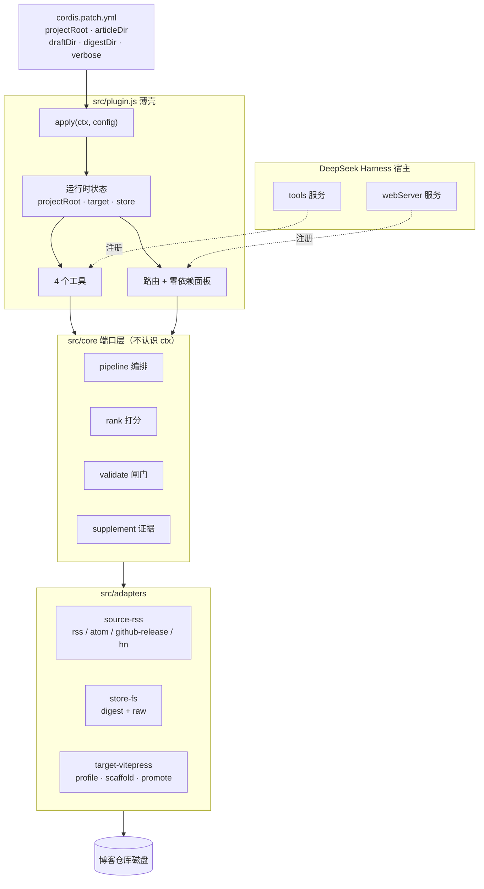

# dsh-hotspot

热点采集 → 去重 → 确定性排序 → 草稿落地。当前只适配 **VitePress** 博客，同时是一个 DeepSeek Harness 插件。

零运行时依赖，纯 ESM JavaScript（Node ≥ 20.6）。`npm test` 用内置 `node:test`，不需要装任何东西。

## 支持哪些博客

**目前只有 VitePress。** 其他生成器（Hexo、Hugo、Astro）需要另写一个 `Target` 适配器——core 不用改，但适配器现在还不存在，`target.kind` 只认 `vitepress`。

"支持 VitePress" 具体意味着这些约定：

| 约定 | 说明 | 可改 |
|---|---|---|
| 文章是 `<目录>/<slug>/index.md` 或 `<目录>/<slug>.md` | 两种布局都能扫到 | — |
| 已发布文章目录 | 默认 `docs/article` | `target.articleDir` |
| 草稿目录 | 默认 `.drafts`（**站点目录之外**） | `target.draftDir` |
| frontmatter 字段 | `title` / `description` / `createTime` / `date` / `tags`，**不写 `permalink`** | — |
| 草稿不进站点地图 | 草稿在站点外时不需要；在 `docs/` 内才写 `sitemap: false`，`promote` 时删掉 | — |
| tag 词表 | 从存量文章归纳，同一 tag 的多种写法按小写归并 | — |
| `init` 时项目里要有 `docs/` | 没有就判定"这不是一个 VitePress 项目" | — |

`docs/` 之下怎么分层随你：文章直接在 `docs/` 一级就把 `articleDir` 设成 `docs`，放 `docs/posts/` 就设成 `docs/posts`。草稿目录同理。

**草稿默认放在 `docs/` 外面**（`.drafts/`），这是有意的：VitePress 只构建 `srcDir`，站点目录之外的 Markdown 根本进不了产物，也就不需要任何博客侧配合。把草稿放在 `docs/` 里会有三个麻烦——它们照样被构建成页面、只靠 `sitemap: false` 从站点地图里剔除、而那个字段能不能生效取决于你博客侧的插件。`hotspot doctor` 在检测到草稿目录落在站点内时会给出警告。

只有草稿确实配置在 `docs/` 内时，`scaffold` 才会写 `sitemap: false`（那种布局只能靠博客侧解释这个字段来兜底）。转正时无论有没有这个字段都会删掉。

## 为什么不用模型打分

排序是确定性的算术：

```text
score = 3.0 × log2(1 + 跨源数)
      + 1.5 × 新鲜度(0..1, 半衰期 24h)
      + 2.0 × 关键词命中(权重和, 封顶 1)
      - 5.0 × 黑名单命中
```

理由有三条，都不是"省钱"：

1. **可复现**。同一批数据跑两次结果一致，你能判断候选质量下降是源变差了还是算法抖了。
2. **可解释**。每一条的分都拆进 `scoreParts`，digest 里能直接算给人看。
3. **不引入新的故障模式**。模型排序会编造来源、抬高评分、把转载当首发；那些只能靠"候选集 URL 白名单"打补丁，而补丁本身就是新的耦合。

`whyNow` / `angle` 这类判断留给"你拍板之后"——那时 agent 在会话里有完整上下文，比流水线里盲猜一遍准得多。

## 架构：端口与适配器

core 只认五个接口，不知道自己跑在 DSH 还是 CLI 里：

| 端口 | 职责 | 适配器 |
|---|---|---|
| `Source` | 拉取条目 | rss / atom / github-release / hn |
| `Ranker` | 排序 | 确定性公式 |
| `Store` | 落盘 digest 与原文 | 文件系统 / 宿主 storage |
| `Clock` | 当前时间 | 系统时钟 / 冻结时间（测试） |
| `Target` | 项目知识与草稿落地 | VitePress / （可扩展 hexo、plain、outbox） |

`src/core/` 里不出现 `ctx`、不出现 `article`、不出现 `sitemap`——那些词只准出现在 `src/adapters/target-vitepress.js`。

## 处理流程

整条链路是三段：**采集是批处理，写作是会话里按需触发，校验是发布前的硬闸门**。三段之间只通过磁盘上的文件交接（digest、raw、`index.md`、`sources.json`），没有常驻进程、没有内存状态依赖——所以任何一步都可以隔天重跑。

### 1 采集：一次 run 里发生什么



三个关键性质：

- **单源失败不拖垮整体**。失败的源名进 `status.failedSources`，成功源不足一半时 `degraded: true`，候选表顶部会标「严重降级」。
- **只压同源内部的重复，绝不按 URL 全局去重**。两个源订阅同一个 URL 时会被吞掉一条，而「跨源共现」正是排序里最强的信号（`3.0 × log2(1 + 源数)`）——吞掉就等于把这个信号永久归零。跨源合并是聚类那一步的职责。
- **digest 瘦、raw 全**。digest 只留标题、URL、分数与来源列表；raw 存每个源的完整正文，专门给 `check` 做数字比对用。

### 2 写作：一次成稿的调用顺序



CLI 里对应 `hotspot check` / `hotspot promote`，面板里对应「转正」按钮 —— 三处走的是同一段 `src/core/promote.js`。

每步落在磁盘上的东西，决定了下一步能看到什么：

| 步骤 | 写入 | 为什么必须落盘 |
|---|---|---|
| `run` | `.hotspot/digest/*.json`、`.hotspot/raw/*.json` | `check` 要拿一手源原文比数字 |
| `get --registerSlug` | `<draftDir>/<slug>/sources.json` | digest 按天滚动，隔天 latest 里已无该 cluster，来源会丢 |
| `scaffold` | `<draftDir>/<slug>/index.md`、`sources.json` 的 `candidate` | frontmatter 由程序生成；传 `body` 时正文一起落盘；`candidate.id` 是 `check` 定位证据的唯一依据 |
| `write` | 同一个 `index.md`（保留 frontmatter） | 改稿是迭代的：scaffold 只能建一次，改正文走 `hotspot_write` |
| `supplement` | 同一个 `sources.json` | 补料是**证据账本**，不是笔记 |
| `promote` | `<articleDir>/<slug>/{index.md,sources.json}` | 转正后仍要答得出「这段数字从哪读来的」 |

面板的「生成正文」是同一套落盘的另一种触发：一次 completion 直接返回 Markdown，宿主写进草稿并跑校验（见「面板里一键生成成稿」）。

### 3 校验：四道闸门



「证据边界」是三层叠加的：**候选源原文**（digest + raw）、**已登记的补料**（`sources.json`）、**配置里的 `publish.allowedHosts`**。闸门不会因为 `--allow` 变松——它只会因为「你真的读过」而变宽。

有三件事是这版才硬起来的：

- **`promote` 必须过闸**。CLI、面板「转正」、`hotspot_promote` 三处都走 `src/core/promote.js`，违规就拒绝，草稿留在草稿目录。没有 force 开关。
- **候选定位不再靠猜**。`scaffold` 把 `candidate.id` 写进 `sources.json`；`check` 按 id 在最近 14 天的 digest 里找回它当时所在的那份，证据取自**那一天**的 raw。定位不到就判 `candidate-unresolved` —— 以前会退化成「当天全部原文都是证据」，等于没有数字闸门。
- **中文标题不再漏闸**。老实现靠 `slugHint` 或标题反查候选，中文标题两条都匹配不上，于是走了上面那条宽松路径。现在有 `candidate.id` 就不再依赖标题。

## 快速开始

在**你的博客仓库根目录**下跑（`--root` 就是博客项目路径，不是本仓库）：

```bash
node src/cli.js init --root <你的博客目录>   # 生成配置文件，并从存量文章归纳 tag 词表
# 编辑配置里的 sources，换成你关心的源
node src/cli.js run --dry-run                # 只看不落盘
node src/cli.js run                          # 落 .hotspot/digest/YYYY-MM-DD.{json,md}
node src/cli.js scaffold '#3' --body-file post.md  # 一次成型：正文随草稿落盘（省略 --body-file 只写骨架）
node src/cli.js supplement <slug> --url <页面> --file <正文>  # 联网补到的证据，登记后 check 才认
node src/cli.js check <slug>                 # 三道机械校验
node src/cli.js promote <slug>               # 过闸后转到文章目录，去掉 sitemap:false（违规就拒绝）
node src/cli.js publish <slug> --yes         # 校验 → 构建 → 只提交这一篇 → 推送 → 部署
node src/cli.js doctor --online              # 自检：配置 / 目标项目 / 每个源 / DSH 安装状态
```

`init` 写出的 `sources` 只是示例，务必换成你自己领域的源——跨源共现信号要多个源覆盖同一领域才有意义（见「已知限制」）。

`sources` 为空（或干脆没写这个字段）时，扫描不会报错，而是回落到插件自带的默认源（`sopilot-hottweets`）：配置里写了源就只抓配置里的，一个都没写就用默认源。这条判定由 `src/core/sources.js` 的 `resolveSources()` 统一给出，面板的「订阅源清单」和 `hotspot_run` 读的是同一个结果——所以面板显示的生效源一定就是实际被抓的源。清空全部自定义源等于回到默认源。

## 怎么确认它真的可用

分三层，从便宜到贵。**下层不过就别看上层**，否则会把"配置错"误判成"插件坏了"。

| 层 | 命令 / 动作 | 通过的标准 |
|---|---|---|
| 1 项目侧 | `hotspot doctor --online` | 没有 ✗；源能连通、能扫到文章、tag 词表非空 |
| 2 打包侧 | `dsh --profile <名字> --dump-config \| grep -A6 hotspot` | 配置树里出现 `- id: hotspot`，config 正确 |
| 3 运行时 | 启动后在 App 里打开 `<地址>/dsh-hotspot/` | 页面能开、`/api/state` 有数据、会话里能调 `hotspot_run` |

第 2、3 层依赖 DSH 装好并重启。第 3 层是最关键的一层，因为前两层都可能"看起来正常但实际没生效"——踩过的两个坑（`output.render` 返回裸字符串、`output.schema` 写了 `required`）都属于这种静默失败。判断办法：`cordis.patch.yml` 里把 `verbose` 设成 `true`，启动日志应出现

```text
[dsh-hotspot] dsh-hotspot: 插件已加载，projectRoot=/path/to/blog
[dsh-hotspot] tools 服务就绪=true
[dsh-hotspot] 已注册 7 个工具：hotspot_run / hotspot_get / hotspot_scaffold / hotspot_supplement / hotspot_check / hotspot_promote / hotspot_write
[dsh-hotspot] 已注册 N 条路由，管理页 /dsh-hotspot/
```

四行缺哪一行，问题就在哪一层：第一行缺失 = 模块没被加载（看 `did not activate` 列表）；第二行 false = tools 服务没起来；第三行缺失 = 注册抛异常了（异常被 Cordis 吞掉，插件里的 try/catch 会打出来）；第四行缺失 = webServer 没就绪。

## 写正文：先补料，再去 AI 味

骨架是确定性生成的，正文不是。正文要有信息量，就得离开候选源去查官方 release notes、作者博客、issue/PR——那些页面里的版本号和日期，一手源里没有，`check` 会把它们判成编造。

补料（supplement）是这条缝的解法：把"实际读过什么"登记成证据，让闸门知道**证据边界在扩**，而不是用 `--allow` 把闸门关掉。

```bash
node src/cli.js supplement <slug> --url <页面> --file <本地正文> --kind official
node src/cli.js supplement <slug> --list     # 看已登记的补料
```

登记后 `check` 做三件事：补料原文并入数字比对、补料 URL 与域名并入外链白名单、配置里的 `publish.allowedHosts` 继续生效。文件落在 `<draftDir>/<slug>/sources.json`，`promote` 时一起搬到文章目录——转正之后仍答得出"这段数字是从哪读来的"。

草稿要一次成型：写完、去完 AI 味，再用 `scaffold --body-file` 把正文一起落盘，草稿目录里不会出现「（正文待写）」。

```bash
node src/cli.js scaffold '#3' --slug my-post --title '中文标题' --body-file post.md
# 落盘即校验：违规直接列出来，草稿保留，改完重跑 hotspot check
```

`--title` / `--description` 覆盖 frontmatter（正文是中文时基本都要传，否则会沿用英文 RSS 标题）。正文自带 `# 标题` 就原样使用，没有才自动补一个。

顺序是硬的：**写 → 去 AI 味 → check**。去味会改数字写法（`6.1.2` → `v6.1.2`）和删链接，先 check 等于白跑一遍。

DSH 里对应 `hotspot_supplement` 工具：边搜边登记，别等 check 报错再回头补。

两处配套，省掉手工登记：

- **`hotspot_get` 带 `registerSlug`**：把该候选的多源原文一次性登记成补料，并把 `candidate.id` 记进 `sources.json`。digest 按天滚动，隔天再写这篇草稿时 `latest` 里已经没有这个 cluster——写之前先固化一份，check 才能按 id 找回当时的证据。
- **面板里的证据条**：打开草稿/文章的「预览与修改」后，正文上方有一条 `📎 证据 N 条`，展开可看每条补料的标题、类型、字数与正文摘要。转正后这条也还在，因为 sources.json 跟着一起搬走了。

### 面板里一键生成成稿

候选页点「生成草稿」会先弹一个小窗确认**标题与目录名**（标题预填候选标题、目录名预填 `slugHint`，没有就按标题推算、纯中文标题退到 `hotspot-MMDD-NN`）。目录名是永久 URL，改起来比看一眼贵；而且纯中文标题推导不出 ASCII slug —— 以前这一步直接 500。

确认后就是一次成稿，不再是空骨架：

```
POST /api/scaffold {id, slug, title, generate:true}
  ├─ 建草稿（frontmatter + sources.json 里的 candidate.id）→ 立刻返回 job
  └─ 后台任务：候选素材包（摘要 + tags + 一手源原文 + 已登记补料）
                → 一次 completion → 写盘 → 三道校验
面板每 4 秒 GET /api/jobs?slug=…  → 卡片上「✍️ 写作中」→ 完成变标题，失败变「⚠️ 正文失败」+ 重试
写作中可随时取消：POST /api/jobs/cancel  → 信号一路传到模型请求，真停（已写盘的内容不回滚）
```

草稿卡片上直接能看到状态：`✍️ 写作中`（带「✕ 取消写作」）、`⚠️ 正文失败`（带「🔁 重试写正文」）、`⚠️ 校验未过 N`（写完但闸门没过，鼠标悬停看违规清单）、`正文待写` 与 `1234 字`。

为什么是后台任务：一次 completion 几秒到几分钟，同步等会有两个问题——浏览器刷新就丢结果，面板也只能干等。任务状态落在 `<digestDir>/jobs/<slug>.json`，宿主重启后仍能看出上次失败的原因（但**不会自动续跑**）。

草稿已经建好后仍可以单独重跑：草稿箱卡片上的「🔁 重试写正文」打 `POST /api/jobs`，编辑器里的「✨ 生成正文」打 `POST /api/generate`（同步）。同一篇同时只允许一个任务，重复请求回 409 `ERR_JOB_BUSY`。

模型拿到的就是磁盘上已有的材料，写完按同样的规矩落盘：

```
一次 completion（system：只用给定材料写作，不编造事实）
  └─ 提示词 = 选题 + 摘要 + tags + 一手源原文节选 + 已登记补料
        └─ 返回 Markdown → 去掉自带 H1 → 写进草稿（保留 frontmatter）→ 立刻跑三道校验
```

**为什么不用子代理**：那条路要在 HTTP 路由里伪造一个「活着的父代理」才能被宿主接纳（`startActivation` 要求 `request.parent` 与注册表里的是同一个对象引用），宿主版本一变就断——我们已经在这上面摔过两次（`parent` 缺失、方法未绑定 `this`）。它唯一多出来的是「联网搜几篇」，现在由「生成前补齐补料」替代：材料不够就先 `hotspot_supplement`，闸门与落盘完全不变。

入口都收在草稿箱里：卡片整块可点，和「✏️ 编辑正文」进的是同一个编辑器。正文还是空壳时，预览区给出一张「✨ 生成正文」卡片，打 `POST /api/generate`；正文写完以后，编辑器头部的「🎨 正文润色」会展开润色面板，填不填要求都能跑，打 `POST /api/polish`。两种操作完都重新读回磁盘内容并刷新证据条，不用关掉重开。

**喂给模型的不只是标题**。写正文前会按 `sources.json` 的 `candidate.id` 找回候选，连同当天 `raw` 里的一手源原文组成素材包（摘要、tags、每条最多 2000 字、总量 6000 字）。以前只给标题和一串链接，中文标题还会直接定位不到候选——提示词里连选题是什么都没有。

**润色和写正文是两条路**：

```
写正文  POST /api/generate  一次 completion（素材包）→ 写盘 → 校验
润色    POST /api/polish    一次 completion（正文 + 你的要求）→ 清洗产物 → 写盘 → 校验
```

润色面板里的要求是自由文本，也可以点预设（去 AI 味 / 更口语 / 精简七成 / 每节加例子 / 先结论后解释 / 只修语病）往里追加。**润色可以反复做**：每次都以磁盘上的最新正文为底稿，改完要求再润一遍即可。

润色的硬边界写在提示词里：只改表达，不改事实；数字、版本号、日期、百分比、引语、人名、公司、职位、链接原样保留；不许新增原文没有的信息，也不许把「据报道」改成肯定句；小标题层级与「## 参考」里的链接一条不少。落盘前还会把润色前后的数字与链接抽出来比一遍，缺了或多了不拦截，但会在面板上点名（例如「少了 1 个数字（如 42）」），让人自己决定要不要留。

一个例外：正文为空时没有可润色的东西，润色面板会直接提示并给出「先生成正文」的入口。

几处刻意的设计：

- **写盘和闸门不在模型手里**。模型只返回 Markdown，写正文、跑校验都是确定性的宿主代码——模型再能编，也进不了「已校验通过」。
- **来源原文一起交回来**。产物里的 `sources[].content` 会进 `sources.json`，数字闸门才认得出正文里的版本号；没带原文的来源只记一条「没有原文，数字无法比对」，不当作证据。
- **不联网**。写正文只用磁盘上的材料，所以「材料够不够」变成看得见的事：不够就先登记补料。联网找来源留给人在会话里做（或 agent 用 `hotspot_supplement` 登记）。
- **慢是正常的**。一次几秒到几分钟，按钮期间禁用；默认 8 分钟超时，超时抛错不写草稿。
- **没接 llm 就明说**。宿主没提供 `llm` 服务时接口回 501，面板提示「当前环境没有接入 llm 服务」，不会假装写成。

产物落在 `<digestDir>/writer/<slug>.json`，跟 digest 同生命周期，方便事后查「这次是谁、读了什么、写了多少字」。

### 写作方式与模型选择

设置页有一张「模型与写作方式」卡，三行选择 + 两个方式按钮：

```
默认       —— 没被覆盖的用途都用它
写正文     —— 默认「跟随默认」；材料多、要长上下文时挑大模型
润色       —— 默认「跟随默认」；短任务，可以挑更便宜更快的模型
```

存盘结构 `<digestDir>/writer-config.json`：

```json
{
  "version": 2,
  "mode": "agent",
  "global": { "provider": "", "model": "" },
  "writer": { "provider": "", "model": "" },
  "polish": { "provider": "", "model": "" }
}
```

覆盖项必须成对出现（provider + model 都给），只给一半等于没选；清空即回到跟随默认。旧版扁平的 `{ provider, model, mode }` 读进来当成 `global`，行为不变。

接口：

```
GET  /dsh-hotspot/api/models   # 模型目录 + 完整选择 + writer/polish 各自解析到的路由
POST /dsh-hotspot/api/models   # 局部更新：{"mode"?, "global"?, "writer"?, "polish"?}
```

**面板选的模型是真的会生效的**：写正文与润色各自解析成一条路由，直接作为 `llm.stream({ provider, model })` 的参数；解析不到就明确报「没有可用的模型路由」，不会悄悄用别的模型跑一遍。

**证据只有一处来源**：提示词里的材料就是 digest 的候选源原文 + 已登记的补料（`sources.json`）。模型看不到别的，所以它不会「顺手搜到一段网上没有出处的话」——材料不够时它会写「尚未披露」，而不是编。

落盘与闸门固定一条路：`writeBody` + `checkDraft`，没有「模型直接写进文章目录」的通道。

模型目录的读取是容忍式的：宿主的 `listProviders()` / `listModels()` 返回形状随适配器版本变化（`provider`/`route`/`id`、`model`/`id`/`name`），拿不到路由的条目直接不显示——宁少一个选项，也不给一条会在生成时才炸的假路由。

## 错误日志

出错时只有一条 toast，刷新就没了；写作任务失败也只留在 `jobs/<slug>.json` 里。所以插件把错误记到 `<digestDir>/errors/YYYY-MM-DD.jsonl`（一行一条 JSON）：

```
{ "at": "...", "source": "writer", "code": "", "message": "模型没有返回正文", "slug": "demo", "detail": "..." }
```

- **默认只留当天**（`log.keepDays` 默认 1）：写入时顺手删掉超期的文件。错误日志的价值随时间掉得很快，留久了只是占磁盘，而清理又常被忘掉。
- **记哪些**：抓取失败、**生成草稿与重写正文的每一次失败**、写作任务失败、润色失败、工具与路由注册失败、CLI 命令失败。**不记每次请求**——一旦变成访问流水就没人看了。
- **失败带上来源与 code**：`scaffold`（目录名推导不出、slug 非法、标题为空、已经写过）、`writer`（后台任务失败）、`writer-sync`（同步生成 / 重试没起来，含并发 409）、`scan`、`polish`、`tools`、`routes`、`cli:<命令>`。面板「诊断」里一眼能看出是哪条流程。
- **怎么清**：面板「设置 → 诊断」里有「刷新 / 清空日志」，或者 `DELETE /dsh-hotspot/api/errors`；`POST { "date": "2026-11-04" }` 只清那一天。
- **CLI 也记**：`hotspot` 命令失败时用同步写入落一条（`process.exit` 等不及 Promise）。
- **写日志失败不影响主流程**：它只是诊断设施，出问题只会打一行 console。

## 三道机械校验

发布前必须全过，否则文章只能留在草稿目录：

| 检查 | 拦什么 | 实现 |
|---|---|---|
| 数字字面比对 | 把 `24.9` 写成 `24.10`、把版本号记错 | 文章里的 `\d+(\.\d+)+` 必须出现在一手源或已登记的补料原文里 |
| 站内链接集合 | 死链 | 扫站点 `docs/` 下所有含 `index.md` 的目录建 URL 集合（外加 `docs/public/*.html`），逐个命中 |
| 外链白名单 | 编造来源 | 必须来自候选源、已登记的补料域名，或配置里登记的域名 |

外加 frontmatter 规则：description ≤ 120 字、不写 `permalink`、date 格式、tag 必须来自受控词表（词表从存量文章归纳，同一 tag 的多种写法按小写归并）。

一手源原文单独存 `.hotspot/raw/<date>.json`，不放进 digest——digest 要瘦，数字校验要全。

## 自动发布：三档，默认只开第一档

| 档位 | 产物 | 判定 |
|---|---|---|
| `auto` | 直接进文章目录 | 一手 release 类，白名单源，版本号跨源一致 |
| `draft` | 草稿目录（默认 `.drafts/`，在站点外） | 默认档 |
| `manual` | 只进 digest | 传闻、冲突、黑名单命中 |

`publish.autoTiers` 默认为空数组。要开自动直发就往里加源类型，不要改代码。

### publish 会执行什么

`publish` 只做五步，且**只 `git add` 这一篇的目录**：

```bash
# 1. 构建（可选）：配置里的 deploy.build
yarn build
# 2-4. 只 add 这一篇 → 提交 → 推送
git add <articleDir>/<slug>
git commit -m "post(auto): <slug>"
git push origin HEAD
# 5. 部署：配置里的 deploy.script
./deploy.sh --no-git --skip-build
```

构建与部署两条命令**都从配置读**（`deploy.build` / `deploy.script`），和面板「部署站点」用的是同一份配置。没配 `deploy.script` 时 `publish` 直接失败并提示去配置，不再有写死的默认流水线。

不用 `git add -A` 是有意的：自动发布时工作区通常有你的半成品，一个 `add -A` 就把它们全提交并发上线了。

`deploy.build` 留空就跳过构建，只跑 `deploy.script`——如果你的 `deploy.sh` 自己会构建（很多站点脚本都是这样），这样配就不会重复构建一遍。

### 面板里的「部署站点」按钮（可配置）

控制面板与插件页头各有一个「部署站点」按钮，它执行的命令**由配置决定，不写死在代码里**：

```json
{
  "deploy": {
    "build": "yarn build",
    "script": "./deploy.sh --skip-build"
  }
}
```

- **配置写在博客仓库里**：保存时写入 `<projectRoot>/dsh-hotspot.config.json`（该仓库若已有 `hotspot.config.json` 会同步一份），配置卡片底部显示实际路径；改绑根目录后写到新根，不再写回旧目录。服务端代码更新后需重启 DSH 宿主才生效——运行中的进程不会热加载插件模块。
- `deploy.build` 可选，`deploy.script` 必填；面板按 **build → script** 顺序执行，**任一步失败即停**，不会带着构建失败的旧产物去上线。
- 用**你的登录 shell**（`$SHELL` → `/bin/zsh` → `/bin/bash` → `/bin/sh`，以 `-l -c` 调用）执行，PATH 和终端里一致：从 Finder 启动的 GUI 也能找到 nvm 装的 `node`/`yarn` 与 `ssh-agent` 里的 key。原先用 `/bin/sh -c` 时终端能跑的脚本在面板里会 `command not found`，这是「部署没打通」最常见的原因。
- **没配也能开始**：面板会只读探测博客根目录（`deploy.sh` / `scripts/deploy.sh` / `bin/deploy.sh`，以及 `package.json` 的 `scripts.build` 搭配 `pnpm-lock.yaml` / `yarn.lock`），在配置卡片里给出建议值，点「使用探测结果」填入表单，保存即生效。探测本身不写盘、不冒充已绑定。
- **留空即解绑**：`deploy.script` 为空时接口返回 `ERR_NO_DEPLOY_SCRIPT`；页头按钮此时只在探测到候选脚本时显示，点了会跳到配置页。
- 单步超时 10 分钟，stdout/stderr 各保留末尾 64KB；结果弹窗按步骤分块展示命令、退出码、耗时与输出，失败时标出是**构建**还是**部署**阶段。
- 最近 10 次部署写入 `<projectRoot>/<digestDir>/deploy-history.json`，配置卡片底部显示「上次部署」并可回看详情。
- 并发请求会被 `ERR_DEPLOY_BUSY`（409）挡住，同一时间只跑一次；根目录失效则返回 `ERR_NO_BLOG_ROOT`。
- 路由和其他面板接口一样只接受 loopback 同源请求，不额外做命令沙箱——**谁能拿到这个面板，谁就能执行这条命令**。

## 插件原理

插件只做三件事：**把 core 的端口接到 `ctx` 上、把能力暴露成工具、把状态暴露成页面**。它自己不实现任何业务逻辑——`src/plugin.js` 里出现的最复杂的判断是「有没有配置博客根目录」。



三条边值得单独说：

1. **宿主 → 薄壳是注册，不是调用**。工具和路由都是 `ctx.inject([服务名], sctx => sctx.effect(...))` 里注册进去的，`effect` 返回的 disposer 负责卸载。所以插件热重载不会留下僵尸路由。
2. **薄壳 → core 是端口注入**。`runScan` 每次调用都现场 `createPipeline({ sources, ranker, store, clock })`，core 拿到的全是函数和对象，没有一个是 `ctx`。
3. **core → 适配器是唯一的落盘口**。`src/core/` 里没有一处 `writeFile`，写博客目录的代码只在 `target-vitepress.js` 里。

### 服务端文件分工

薄壳之外，`src/` 下这几块各管一件事（2026-11 的一次纯结构重构拆出来的，行为未变）：

| 文件 | 职责 |
|---|---|
| `plugin.js` | 装配：读配置、建 target/store、注册工具与路由、生命周期 |
| `tools.js` | 七个工具的契约（参数、output schema、render、execute），依赖全部注入 |
| `server/api.js` | 路由表 + 配置读写 + 换绑逻辑 |
| `server/state.js` | `/api/state` 的状态聚合（配置 / 生效源 / 草稿 / digest / 订阅文章 / 任务） |
| `server/deploy.js` | 执行部署命令、截留输出、记部署历史 |
| `server/http.js` | 响应、请求体解析、loopback + 同源守卫 |
| `server/jobs.js` | 后台写作任务的状态机 |
| `server/prefix.js` | `/dsh-hotspot` 与旧前缀 `/hotspot` |

拆分时踩到的一个坑值得记下来：**搬移代码要重新审导入**。`detectDeployPlan` 和 `readDeployHistory` 里的 `readFileSync` / `readFile` 都写在 `try/catch` 里，漏了导入不会报错，只会安静地返回空值——`yarn build` 探测变成空、部署历史变成 0 条。是测试把它们抓出来的，所以重构必须跑全量，不能只看 `node --check`。

### 配置从哪来

| 来源 | 生效时机 | 能改什么 |
|---|---|---|
| `cordis.patch.yml` 的 `config` | `apply` 入参，启动时 | `projectRoot` / `articleDir` / `draftDir` / `digestDir` / `limit` / `verbose` |
| 工作区根目录的 `dsh-hotspot.config.json` 或 `hotspot.config.json` | 启动时读一次（`projectRoot` 为空则整段跳过） | `projectRoot` 及其 `digestDir` / `articleDir` / `draftDir` |
| 面板「设置」页 | 运行时，走 `onConfigUpdated → updateRuntime` | `projectRoot` / 目录名 / `digestDir`（rank、publish 写回配置文件；`rank.limit` 当场对下一次 `hotspot_run` 生效） |
| 工具参数 `projectRoot` | 单次调用 | 临时指定另一份博客仓库，不改全局状态 |

优先级从上到下**后者覆盖前者**（工具参数只影响那一次调用）。

两个已知的不一致，写在这里免得踩坑：

- **缺省文章目录不同**。插件侧 `articleDir` 缺省 `docs`（最早只服务「文章直接放 `docs/` 下」这种布局），而 CLI 走适配器默认值 `docs/article`（`src/adapters/target-vitepress.js` 里的 `config.articleDir ?? 'docs/article'`）。插件的默认值会盖掉适配器的默认值，所以同一个仓库在插件里和 CLI 里可能指向不同目录——配置里显式写死 `articleDir` 就没有歧义。
- **配置键不同**。插件读顶层的 `articleDir` / `draftDir` / `digestDir`，CLI 读 `target.articleDir` / `target.draftDir`。两个键写在同一个文件里，各读各的。

目录的合并顺序是 **面板/宿主显式配置 > 博客仓库配置（顶层键或 `target.*`）> 适配器默认值**。插件以前只认第一层：仓库里写着 `draftDir: ".drafts"`，它的 target 却按默认值去 `docs/draft` 找，于是面板顶部显示一套目录、草稿列表却是空的。现在 `/api/state` 的 `blog.articleDir` / `blog.draftDir` 报的也是 target 实际使用的目录。

候选上限的优先级是 `工具参数 limit > 项目配置 rank.limit > cordis.patch.yml 的 limit`。早期版本把 `config.limit` 写在前面，而 patch 里默认就有 `limit: 15`，于是面板里改的上限永远不生效——现在按上面这个顺序解析。

### 没配置博客目录时会怎样

`projectRoot` 为空或路径不存在 → 进入**未绑定状态**：`target = null`。

| 能力 | 未绑定时的行为 |
|---|---|
| `hotspot_run` | 照常跑，但画像为空（没有 tag 词表、没有关键词加权），排序只剩新鲜度与源数；**digest 只落在进程内存里**，返回 `persisted: false` |
| `hotspot_get` | 读同一份内存 digest（本次会话内能读，重启就没了）；带 `registerSlug` 会返回「尚未配置博客项目根目录」 |
| `hotspot_scaffold` / `hotspot_supplement` / `hotspot_check` / `hotspot_promote` / `hotspot_write` | 返回同一条提示，不抛异常 |
| 面板 | 能开，能在「设置」里填路径，填完立即生效 |

刻意的取舍：**没有默认目录**。猜一个 `~/blog` 或者往宿主进程的 cwd 写 `.hotspot/`，比明确报错糟糕得多——所以在未绑定时抓取照常进行，只是不落盘。

### 七个工具

| 工具 | 参数 | 读 | 写 |
|---|---|---|---|
| `hotspot_run` | `limit?` | 配置文件里的 sources | `.hotspot/digest/*.json`、`.hotspot/raw/*.json`（未绑定时不写） |
| `hotspot_get` | `id`、`registerSlug?` | digest + raw | 仅当传 `registerSlug`：`<draftDir>/<slug>/sources.json` |
| `hotspot_scaffold` | `id`、`slug?`、`title?`、`description?`、`body?`、`projectRoot?` | digest | `<draftDir>/<slug>/index.md` + `sources.json` 的 `candidate` |
| `hotspot_supplement` | `slug`、`url`、`title?`、`content?`、`kind?`、`projectRoot?` | `sources.json` | 同文件追加/覆盖（保留 `candidate`） |
| `hotspot_check` | `slug`、`projectRoot?` | 正文 + 一手源 + 补料 | — |
| `hotspot_promote` | `slug`、`projectRoot?` | 同上 | `<articleDir>/<slug>/{index.md,sources.json}` |
| `hotspot_write` | `slug`、`body`、`projectRoot?` | 已有草稿 | 覆盖正文（保留 frontmatter），写完立刻复核 |

三件事值得单独说：

- **`scaffold` 只能建一次，改稿走 `write`**。草稿已存在时 `scaffold` 会拒绝并提示改用 `hotspot_write` —— 早期版本这里没有出口，agent 拿到违规清单后只能请人去面板改。
- **`promote` 必须过闸**。它内部就是 `checkDraft` → `target.promote`，违规就拒绝、草稿留在原处。没有 force 开关：要放行只有改稿或登记补料两条正路。
- **`hotspot_get` 是唯一「读的时候可能写」的工具**，因为 digest 按天滚动：隔天写同一篇草稿时，latest 里已经没有那个 cluster。`registerSlug` 会把该候选的来源原文登记成补料，**同时**把 `candidate.id` 写进 `sources.json`，写正文前先固化一次是最省事的做法。

### 路由与面板

每个路径同时注册在两个前缀下：`/dsh-hotspot` 和旧前缀 `/hotspot`。所以启动日志里的路由条数是**路径数的两倍**——看到数字对不上先想想这一条。

面板是一个零依赖 HTML（`src/web/panel.html`，脚本内联），不打包、不引框架，由路由直接吐出字符串。所有数据走 `/api/*` 的 JSON 接口，所以面板坏掉时可以直接 curl 排障。

`POST /api/generate` 与 `POST /api/jobs` 是两个会调模型的入口（前者同步、后者后台任务）；宿主没提供 `llm` 服务时前者回 501、后者不建任务并把草稿留在原地。`GET/POST /api/models` 读模型目录与保存按用途的模型选择——没接 `llm` 时 GET 仍回 200 空目录，面板照常打开。

**刻意没做的**：不注册 `/slash` 命令、不注册定时任务。前者要猜命令 outcome 的契约；后者宿主已有「自动化任务」，让它定时调 `hotspot_run` 就行。少两处耦合，就少两处随 DSH 版本失效的地方。

## DSH 插件

`src/plugin.js` 是薄壳（结构见上一节）：把 core 的端口接上 `ctx`，然后就没它的事了。

**已在真实运行时验证**（DeepSeek Harness 0.2.1-rc.5，`dsh web --port 0`）：apply 执行、`tools` 服务就绪、工具注册成功。

接口是从已安装插件的源码里读出来的，不是猜的：

```js
import { defineTool } from '@deepseek-ai/dsh-tools'

export function apply(ctx, config) {            // 具名导出，不用 export default
  ctx.inject(['tools'], (sctx) => {
    sctx.effect(() => {
      const dispose = sctx.tools.register(defineTool({
        name: 'hotspot_run',
        description: '...',
        parameters: { limit: { type: 'number', description: '...' } },  // 扁平 map，不是 JSON Schema
        output: {
          schema: { type: 'object', additionalProperties: false, properties: {...} },
          render(_args, value) { return [{ type: 'text', text: '...' }] },  // 必须返回 ContentBlock[]
        },
        async execute(args) { return {...} },
      }))
      return () => dispose?.()
    })
  })
}
```

两个踩过的坑，写在这里免得再踩：

1. **`output.render` 必须返回 `ContentBlock[]`**。返回裸字符串不会立刻报错，而是在 `tools/post-execute` 阶段把下游消费者（如 hooks）打崩。
2. **`output.schema` 不支持 `required: [...]`**。DSH 用的是自有 value schema DSL，写了会抛 `unsupported JSON schema: schema.required is not supported`，而 Cordis 会把 `inject` 回调里的异常静默掉——表现是"插件加载了但工具不存在"。所以 `plugin.js` 里注册块被 try/catch 包住并显式 `console.warn`，这个包装不要拆。

刻意没做的：**不注册 `/slash` 命令、不注册定时任务**。前者要猜命令 outcome 的契约；后者宿主已有「自动化任务」，让它定时调 `hotspot_run` 就行。少两处耦合，就少两处随 DSH 版本失效的地方。

### 安装

```bash
# 官方入口（走 pnpm，会写 profile 的 dependencies）
dsh plugin --profile <profile> add <本仓库路径>

# 然后把 hotspot 加进 profile 的 dsh.profile.bundles
#   ~/.dsh/profiles/<profile>/package.json
```

`cordis.patch.yml` 会作为一层 patch 自动应用（见 `package.json` 的 `dsh.bundle.patch`），里面的 `config` 就是配置面，改它不用改代码。

### 装进 DeepSeek Harness Desktop

Desktop 的 `desktop` profile 由 Electron 独占管理，`dsh plugin --profile desktop add ...` 会直接报 `profile "desktop" is managed exclusively by the Electron application`。Desktop 内改走应用自己的插件管理：

1. **一次性接入**：profile 的 `dependencies` 用 link 指回本仓库，并把 `dsh-hotspot` 写进 `dsh.profile.bundles`（`~/.dsh/profiles/desktop/package.json`）：

   ```json
   "dsh-hotspot": "link:/Users/laijihua/Desktop/Code/hotspot"
   ```

   还要让插件**启动即知道博客仓库在哪**：宿主是从进程 cwd 读工作区配置的，Desktop 下这个 cwd 是 `~/.dsh/profiles/desktop`。在那里放一份只含 `projectRoot` 的 `dsh-hotspot.config.json`：

   ```json
   { "projectRoot": "/Users/you/Code/my-blog" }
   ```

   不然每次重启 App 后都是未绑定状态（面板显示「未绑定路径」），要手工再绑一次。真正的配置（sources / publish / deploy）仍以博客仓库里那份为准——插件读到这个 `projectRoot` 后会跟随过去读它。

2. **改完代码怎么让它生效**：宿主加载插件用的是裸 `await import(url)`（`cordis-plugin-loader` 的 `import()`），Node 在同一个进程内会复用已求值的模块 —— 所以 `plugin_manager` 的禁用再启用拿到的**仍然是内存里那份旧代码**。改 `src/plugin.js` / `src/server/**` / `src/core/**` / `src/adapters/**` 之后必须**完全退出并重开 DeepSeek Harness**（不是关窗口）。

   `src/web/panel.html` 每次请求读盘、`src/client.js` 由页面加载，改这两处刷新页面即可。

   > 旧文档说「禁用再启用就能生效，不需要重启」——那条是错的：它看起来生效过，是因为当时改的恰好是 panel.html 或 client.js。判断办法写在下面。
3. **验证**：`/hotspot/` 返回 200；`/dsh-hotspot/rss.xml` 返回 200 且 `content-type: application/rss+xml`；`/dsh-hotspot/api/state` 的 `feed` 里有 `rssPath`。
4. **怎么确认进程里跑的是不是最新代码**：设置页 →「诊断」会显示「插件代码载入于 …」；如果磁盘上有文件比这个时间新，它会直接标黄：`磁盘上的插件代码比进程里新（N 个文件…），要完全退出并重开 DeepSeek Harness 才生效`。对应的接口字段是 `/api/state` 的 `runtime.loadedAt` 与 `runtime.stale`。

验证加载是否成功：`cordis.patch.yml` 里把 `verbose` 设为 `true`，启动后应看到

```text
[dsh-hotspot] dsh-hotspot: 插件已加载，projectRoot=...
[dsh-hotspot] tools 服务就绪=true
[dsh-hotspot] 已注册 7 个工具：hotspot_run / hotspot_get / hotspot_scaffold / hotspot_supplement / hotspot_check / hotspot_promote / hotspot_write
```

## 管理界面

插件启动后会在 DSH 的 web server 上挂一组路由。**管理功能在 DeepSeek Harness 侧栏的 dsh-hotspot 面板里**（候选、草稿箱、写正文/润色、设置页）。同一组路由下还留着一个独立的兼容页面：

```text
<你的 DSH 地址>/hotspot/
```

它只做快速查看（候选、订阅源、RSS 地址），页面顶部有醒目提示；写正文、转正、模型选择这些能力只在应用内面板里。保留它的理由有两条：书签与 shell 里的 `curl` 还能用，以及面板本身坏掉时能拿来对接口。

四个页签：

| 页签 | 能做什么 |
|---|---|
| 源 | 增删 RSS / GitHub releases / HN 三种源，保存即写回配置文件；底部是 RSS 订阅地址（复制 / 打开） |
| 候选 | 一行候选计数 + 最近抓取时间，搜索与「全部 / 精选 / 多源」筛选；每条只看标题、两行摘要与来源，直接生成草稿；候选之外的原始条目折叠在「今日其他文章」里 |
| 内容 | 草稿与已发布文章列表，可预览、在线编辑、转正 |
| 设置 | 候选上限、时间窗、半衰期、去重阈值、外链白名单、构建与部署命令；画像 tag 与关键词只读展示 |

### 订阅今日候选（RSS）

订阅地址在「源」页底部，点「复制地址」即可；也可以直接在阅读器里添加：

```text
<你的 DSH 地址>/dsh-hotspot/rss.xml
```

排序与去重规则是确定性的：

- **候选在前**：当天候选按排名写入，`pubDate` 取 digest 的生成时间，所以按时间倒序展示的阅读器也会把候选排在最前；
- **文章在后**：随后是当天订阅源抓到、但没有进入候选的原文，按各自的发布时间倒序，没有发布时间的垫在最后；
- **单次最多 80 条**，以避免一次把一天上千条原文推给阅读器；
- 候选 URL 与它命中的来源 URL 会先做规范化，同一篇不会在源里出现两次；正文不会进订阅源，`description` 只有摘要；
- **每条都标来源**：`description` 首行是 `来源：<订阅源名>`，带源地址的源同时输出 RSS 2.0 的 `<source url="…">` 元素；候选是多源共现，会写成 `来源：A、B、C`，方便判断这条是单源还是跨源撞出来的；
- 源名优先用配置里的 `name`，没配就按类型兜底（github-release 用 `GitHub · owner/repo`、hn 用 `Hacker News`、rss 用域名），面板与订阅源用的是同一套映射；
- 与 `/api/*` 使用同一道 guard：只接受本机同源请求。要从别的设备订阅，请走 SSH 隧道之类的方式，不要把端口直接暴露到公网。

接口都在 `/hotspot/api/` 下，普通 Node http handler，可直接 curl：

| 方法 | 路径 | 说明 |
|---|---|---|
| GET | `/hotspot/api/state` | 一次返回 sources / config / articles / drafts / 最新 digest |
| POST | `/hotspot/api/sources` | 整体写入源列表（带 id 与字段校验） |
| POST | `/hotspot/api/config` | 局部更新 projectRoot / 目录 / rank / publish / deploy.{build,script}（合并语义，只传 build 不会抹掉 script） |
| POST | `/hotspot/api/run` | 触发一次抓取；已有一次在跑时回 409 `ERR_SCAN_BUSY` |
| POST | `/hotspot/api/scaffold` | 按候选 id 生成草稿（`slug` / `title` / `description` 可覆盖）；`generate:true` 时建完立刻在后台写正文并返回 job；slug 推导不出回 400 `ERR_SLUG_REQUIRED` |
| GET | `/hotspot/api/jobs` | 后台写作任务列表（`?slug=` 过滤） |
| POST | `/hotspot/api/jobs/cancel` | 取消正在跑的写作任务；没有在跑的回 404 `ERR_NO_RUNNING_JOB` |
| GET | `/hotspot/api/errors` | 当天的错误日志（`?date=` / `?limit=`），附现有日志文件列表 |
| POST / DELETE | `/hotspot/api/errors` | 清空错误日志；带 `{ date }` 只清那一天 |
| POST | `/hotspot/api/jobs` | 按 slug 重跑写正文（失败重试）；同篇在跑时 409 `ERR_JOB_BUSY` |
| GET | `/hotspot/api/article` | 读正文，附带 `supplements`（补料条数与摘要） |
| POST | `/hotspot/api/article` | 保存正文 |
| POST | `/hotspot/api/article-promote` | 草稿转正（过闸；违规回 409 `ERR_CHECK_FAILED` + 违规清单） |
| POST | `/hotspot/api/deploy` | 按 `deploy.build` → `deploy.script` 顺序执行（未绑定 → 400，已在跑 → 409），返回分步退出码与输出，并落一条部署历史 |
| GET | `/hotspot/rss.xml` | 今日候选（前）+ 今日订阅文章（后）的 RSS 2.0 订阅源，`content-type: application/rss+xml` |

**为什么不做 React 客户端插件**：`dsh.client` 需要引入客户端构建链，还要绑定预发布期的客户端 UI API。这几个页面都是表格和表单，单个零依赖 HTML 足够；省下的是一整条会随 DSH 版本失效的耦合。

**安全**：插件路由不走平台鉴权（`webServer.register` 的语义如此），所以自己守一道——只接受 loopback 来源、拒绝 `sec-fetch-site: cross-site`、`origin` 与 `host` 必须同源。这三条对应 `src/server/api.js` 的 `isAllowed()`。

## 已知限制

- **只支持 VitePress**。换生成器要写 `Target` 适配器（`src/adapters/target-vitepress.js` 是唯一实现）。
- **部署靠你自己配的命令**：插件只负责按 `deploy.build` → `deploy.script` 顺序执行、截留输出、记历史；构建产物目录、上传方式、探活地址都在你的脚本里，插件不猜。
- **`github-release` 源走 releases.atom**，不需要 token。本地网络若访问不了 github.com，该源会失败并在 digest 状态行里列出来——单源失败不影响其他源。
- **跨源共现信号要有重叠才生效**。如果几个源各覆盖一块不重叠的领域（比如 HN + 一个官方博客），所有条目 `sourceCount` 都是 1，共现项退化成常数，排序实际由新鲜度和关键词决定。想让这个信号有意义，得让多个源覆盖同一领域。
- **中文标题不生成拼音 slug**，`slugHint` 可能为空，`scaffold` 会要求显式 `--slug`。这是刻意的：拼音目录名后面还得手工重命名。
- **`.hotspot/errors/` 默认只留当天**，与 raw/digest 的 30 天保留策略分开（错误日志过期更快）。
- **`.hotspot/raw` 会自动清理**。每次抓取结束后删掉超过 `store.keepDays`（默认 30 天）的 digest 与 raw，`latest.*` / `writer/` / `jobs/` / 部署历史都不动。`check` 只往回找 14 天，30 天够用；要留更久就把它调大。
- **`promote` 是硬闸门，没有 force**。要放行只有两条路：把正文改到证据边界内，或把真正读过的页面登记成补料。MCP/宿主级强行改文件当然绕过它——闸门防的是流程上的惯性，不是防有磁盘权限的人。
- **同时只允许一次抓取**。两次并发 run 会互相覆盖当天的 digest 与 raw，所以入口用单飞挡掉：第二次直接回 409 `ERR_SCAN_BUSY`，不排队——排队会把「点两下」变成「跑两次」。
- **同一天重跑 `run` 会覆盖当天 digest**（`<date>.json` 与 `latest.json`），候选 id `h-YYYYMMDD-NN` 会按新排序重新分配。草稿不受影响（它记的是 `candidate.id`，check 按 id 往回找），但**对话里的「#3」会指向新的第三条**。
- **`hotspot_write` 不建草稿**。它只往已有草稿写正文；没有草稿就先 `hotspot_scaffold`。
- **后台写作任务不跨宿主重启续跑**。状态文件（`<digestDir>/jobs/<slug>.json`）留着，所以失败原因还看得到；但进程没了就是没了，重开面板后要点「重试写正文」。
- **写正文不联网**。提示词里只有候选源原文与已登记补料，所以「这篇文章的材料够不够」直接决定了成稿质量：不够就先 `hotspot_supplement` 登记真正读过的页面。联网找来源不在流水线里，这是刻意的（见「为什么不用子代理」）。
- **digest 不进版本库**（`.hotspot/` 已 gitignore）。它是过程产物；真正要留痕的判断应该写进文章或 commit message。
